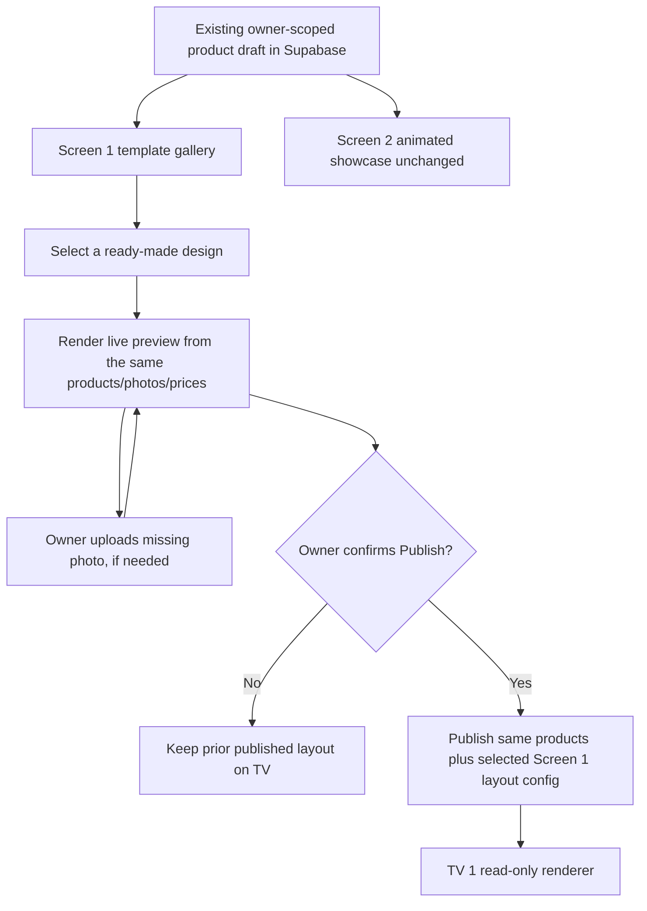

# Screen 1 Menu Template Gallery — Design Proposal
**Status:** In review, owner decision pending (2026-11-12).
**Scope:** Screen 1 only; Screen 2's animated drink showcase stays unchanged.
**Prototype:** `Seiyun_Menu_Generator_Interactive_Preview.html` (standalone, offline-friendly interaction spike; not part of deployed app).

## Problem
Café owners should not arrange item cards, choose columns, or retype products every time they dislike a menu's appearance. The current 23-item photo-first layout produces tiny drink photos and the owner wants instant access to attractive menu designs that populate automatically from the existing Supabase catalog. Owners need the fewest possible decisions: choose design, upload missing product photos, preview, publish.

## Goals and non-goals
- Three high-quality ready-made designs at initial launch: **Complete Menu** (all 23 on one portrait screen), **Photo + Details** (left image/right copy, category rotation), **Premium Editorial** (hero photo and category list, rotation).
- One-click preview populated with all existing Seiyun product names, ingredient notes, sizes, prices, and uploaded product photos; NEVER reenter product data when switching design.
- Missing photographs use clearly labeled placeholders; no substitutions with wrong drinks, no random AI photos.
- Keep owner editing workflow, both-screen preview, Supabase Auth, owner-scoped private drafts, Publish and rollback.
- Avoid manual drag-and-drop, new CMS, external checkout, changing Screen 2, forcing new uploads, or publishing automatically.
- Visual clarity, full-drink photo fit default, and accurate currency/amounts must survive layout changes.
- Measurable owner experience: switch and preview designs within seconds; select the first design with zero manual formatting work.

## Approaches considered
1. **Import third-party restaurant HTML/CSS/JS wholesale.** Faster initial screenshot but duplicates catalog/data, includes irrelevant shopping/checkout/website behaviors and risky JS dependencies; Bootstrap 6 alpha requires modern browsers, unsuitable for older Samsung TVs.
2. **Recommended:** curate legally vetted MIT-licensed restaurant menu visual components and adapt the HTML/CSS patterns into a **small template registry** bound to our existing immutable menu data and owner draft/publish flow. Attractive real-world designs without forcing owners to use a design editor. Each layout reviewed on a portrait Samsung TV.
3. **GrapesJS freeform editor or homegrown template controls.** More owner work and additional support/QA burden, contrary to explicit feedback.

Candidate sources: 
- `aymalkhalid/restaurant-menu-pages`: README declares MIT and three HTML/CSS page templates. **Verify code/license terms and separately prove every source image's reuse rights before copying assets**; root repository listing did not show a standalone LICENSE file.
- `caresdev/restaurant-menu`: README declares MIT and a vanilla JS data.json-driven restaurant menu. Includes unrelated cart/payment/WhatsApp flow that must not enter the TV runtime.
- `themefisher/restaurant-bootstrap`: MIT code; explicitly excludes example image rights. Archived; avoid old runtime dependencies.
- `ColorlibHQ/bootstrap-templates/tavola`: MIT, but built on Bootstrap 6.0 alpha, browser compatibility Chrome/Edge 130+, Firefox 132+, Safari 18+. Avoid embedding its JS into older Samsung TVs.

## Design and data model

Proposed optional `draft.menuTemplate={id:'complete-v1'|'photo-rows-v1'|'editorial-v1',version:1}` in existing JSON, defaulting to `complete-v1` when absent. Publishing carries this field into the existing live snapshot, no new table or bucket. Preserve an unknown or retired template ID safely by falling back to the original menu design and showing owner a warning. Each template consumes the same normalized visibleProducts() data; no second product database. Screen 2 ignores the field. For big-photo designs category auto-rotation is part of the explicit template characteristic and is displayed clearly in the chooser.

## Threat model (STRIDE)
- Spoofing: Owner-only template selection and photo upload continue through existing Supabase Auth.
- Tampering: Template IDs are allowlisted; never execute owner-supplied HTML/JS or an arbitrary remote template URL. Server-side RLS and publish rights remain unchanged.
- Repudiation: Existing revision history/rollback records published template ID and product state.
- Information disclosure: Draft URLs/data are not exposed to public TV endpoints; public TV uses published snapshot only.
- Denial of service: Bound photo size/dimensions and number of repeatable elements; avoid untrusted runtime dependencies and unsupported CSS/JS; show category overflow/cutoff warning.
- Elevation of privilege: No arbitrary upload bucket paths, scripts, frame embeds or privileged editor endpoints.
- Supply-chain/IP: Pin reviewed source commit, preserve MIT notices, audit image licenses separately, bundle reviewed assets locally.

## Preview and testing
- 23 products render under Complete Menu without pagination; Photo + Details / Editorial rotate through all categories automatically with no omitted products.
- Names, prices, and ingredient notes exactly match draft; missing-photo labels clear; no false photos.
- Switching templates does not change product data, upload mappings, Screen 2 preview, or already published TVs.
- Publish changes only TV 1 layout; rollback restores prior layout.
- Test actual 1080×1920/portrait Samsung TV, MacBook owner editor and narrow browser; no clipping/truncated prices, text readable from viewing distance, no runtime exceptions.
- Test unauthenticated access, second owner account isolation, unknown template ID, partial/no photos, changed category, large catalog.
- Collect owner feedback about time-to-first-publish and template selection rate.

## Rollout
1. Finalize owner decision on initial 3 layouts and category rotation vs single-screen visibility.
2. Verify license/asset eligibility and adapt source patterns in an isolated code branch.
3. Deliver working authenticated draft gallery + preview behind a preview flag; leave published TV renderer unchanged.
4. Verify Samsung TV and published/rollback flow; then enable choosing templates for live publication.

## Outstanding decision
**Owner approval required:** Launch the three proposed template families, with one all-products design and two category-rotating designs? If not, alter catalog strategy before writing production code.

## Missing methodology references
The project's Spec Before Code upload refers to `assets/spec-template.md` and `assets/threat-model.md`, but neither supporting reference was provided. This spec includes equivalent required sections and STRIDE threat modeling until those exact references are available.
