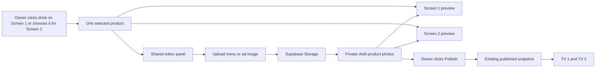

# Two-screen always-visible owner editor — design
Status: Implemented on GitHub main; Cloudflare deployment and physical TV validation pending (2026-11-12).
Scope: owner Studio only; existing TV menu/showcase layouts remain unchanged.

## Problem
Owner sees only Screen 1 while editing a drink; Screen 2 disappears behind a separate Preview tab. This makes it impossible to see or assign a promotional image while working on the same menu. Owner explicitly requests both screen previews remain visible with buttons to edit either and apply images.

## Goals and non-goals
- Both portrait previews remain on the Edit menu page, including when an item is selected, and on narrower displays (stack rather than hide).
- Clicking a Screen 1 card selects that product; Screen 2 preview shows that product's advertisement or a clear missing-photo placeholder.
- Edit panel has distinct Screen 1 and Screen 2 photo upload/selection controls; both use the same product photo library and online draft.
- Default Screen 2 photo = Screen 1 photo, with an optional per-product Screen 2 photo choice.
- Preserve all 23 products, prices, ingredients, the full-cup image fit, Fraunces/DM Sans, draft/publish/rollback, and TV display layout.
- No freeform image dragging, new product tables, secret sharing, or automatic publishing.

## Approaches
1. **Recommended and requested:** side-by-side persistent previews + a single contextual inspector; optional independent photo selection per product for the showcase. Both views match their published renderers. Uses existing JSON draft fields, costs nothing extra.
2. Two tabs for Screen 1/2: less crowded, but conceals the other screen during editing; rejected because it violates “both there all the time”.
3. Two independent product editors: duplicates products and risks inconsistent prices/ingredients; rejected.

## Design and data flow

No schema change: `products[].photos[]` already holds authorized Storage URLs and `products[].primary` selects the Screen 1 photo. Optional `products[].showcasePrimary` (integer index into same photos) selects Screen 2; missing or invalid index falls back to `primary`. Screen 2's existing rotation still uses visible photographed products. The editing preview may focus on the currently selected drink without changing the eventual TV rotation. Editor preview is owner-only; customer URLs and publishing continue unchanged.

## Threat model
- Spoofing: owner login remains Supabase Auth; neither screen editor control bypasses authorization.
- Tampering / escalation: upload still uses owner-scoped Storage policies; draft rows remain owner-scoped; publishing still runs the authenticated RPC.
- Information disclosure: public TV previews must read only the published snapshot; private editing previews never share draft URLs.
- Denial of service: image size limits and browser conversion path stay in place.
- Repudiation: published revisions retained; draft image choices are not published until Publish.

## Test plan and acceptance
- At desktop width, both complete portrait previews and inspector appear simultaneously. Selecting a card changes inspector but does not remove either preview.
- Buttons for Screen 1 and Screen 2 can upload photos; one photo used for both by default, separate selected ad photo only affects Screen 2.
- Re-render on edit/name/price/image updates both previews without changing other cards.
- Missing-photo state stays visible and actionable.
- Mobile/narrow screens stack both previews and inspector.
- Regression: no JS errors; 23 menu items remain; no changes to public TV layout; Supabase draft/save/publish unchanged.
- Live Cloudflare deployment and Samsung hardware checks are pending until verified.
