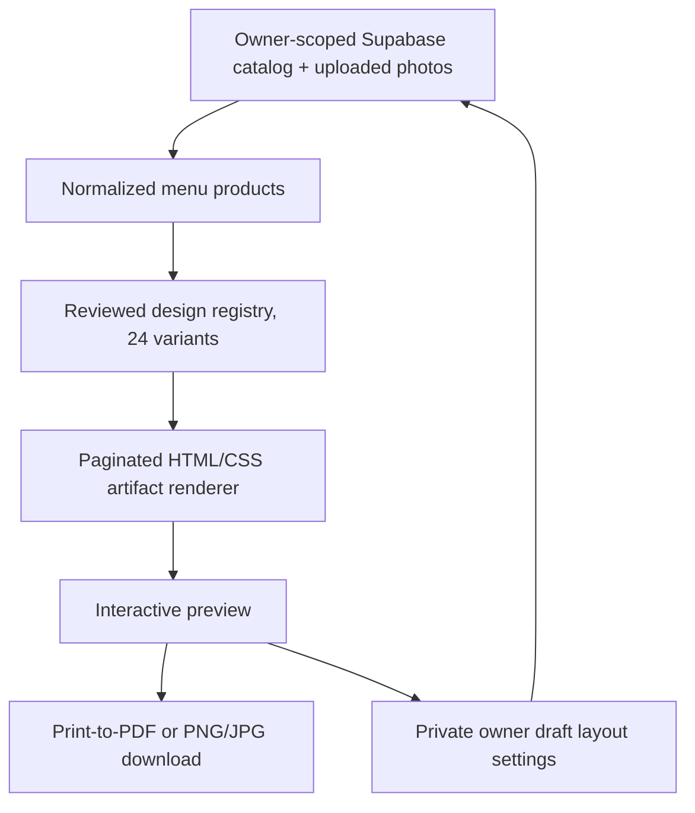

# 0001 — Export-first menu design library
Status: Accepted for implementation by owner's explicit "go ahead" on 2026-11-23.
Scope: Menu Generator artifact production. Existing animated Screen 2 unchanged.

## Problem
Owners already have ways to display/print menus. Seiyun must create downloadable menu artwork using each owner's own names, prices, ingredients, product images and categories. The old TV-centric 2–3 designs and fixed tiny images do not meet the requirement. Owner explicitly requested a 20–30 choice initial gallery, photo prominence controls, end-to-end delivery and tests.

## Goals
- Initial **24** gallery choices, not a permanent cap: 8 visibly distinct layout compositions with 3 style treatments each. Make the design registry extensible without changing catalog fields.
- Label choices honestly: 24 curated adaptations/variants informed by permissively licensed open-source restaurant menu code, **not** 24 independent GitHub projects. Never ship sample photography or unreviewed remote HTML/JS.
- Owner chooses a look; existing catalog auto-fills without reentry. Photos are those attached to the matching product, or an explicit "Add photo" placeholder.
- Global image-space slider and optional per-product override; default to full-photo `contain` with no cropping. Separate "fill/crop" choice may be offered only with a clear warning.
- Reliable multipage pagination: every enabled product appears once for each chosen design and format; no silent omission.
- Export multipage print/PDF using the browser's print → Save as PDF; PNG/JPG downloads (including multipage ZIP where dependencies load); responsive gallery; draft persistence.
- Document output sizes (Letter, A4, Square, Digital Portrait, Landscape) as export artifacts, not TV pairing.
- Preserve Supabase owner auth, RLS, photo uploads, backup, catalog editing and Screen 2 advertising.

## Non-goals
No TV integration or Samsung-specific requirement, no subscription designer/drag-drop, no new backend table, no auto-import of arbitrary GitHub repos, no inclusion of stock images, no forced publish-to-TV step to download, no rewrite of existing prices/catalog.

## Approaches
1. Copy 24 independent GitHub websites wholesale. Rejected: site-specific JS/checkout/carousels, inconsistent licenses and data schemas, untrusted scripts and fragile exports.
2. **Selected:** integrate reviewed layout patterns from MIT restaurant menu code into a stable, versioned catalog-driven renderer. 8 composition families x 3 treatments =24 ready-to-use choices, each automatically populated and exportable. Later source imports can add designs by adding registry entries and reviewed renderer variants. Tradeoff: not 24 distinct GitHub projects.
3. Embed GrapesJS and ask owners to design. Rejected as owner work.

## Architecture

Data: add optional `draft.menuArtwork` with `templateId`, `format`, `imageSpace` (percent 25–70), `photoSizeByProduct` map (id → 25–70). Unknown/invalid config falls back to safe default. No new table. Existing product IDs, `photos[]`, `primary` drive images; no synthetic image URL. One immutable `getProducts(draft)` selects enabled products, preserves categories, prices, sizes and ingredients. Use allowlisted `layout` and `tone` in renderer; output escaping for all owner data and URL validation for image tags. A Print sheet consists of one or more pages; predictable per-layout capacity with overflow verification; user sees "Page 1 of N". Library never executes code supplied by a template author.

## Threat model — STRIDE
- Spoofing / escalation: existing Supabase auth and owner-scoped draft/storage policies stay unchanged; no unauthenticated path to owner artwork.
- Tampering: all template IDs/styles allowlisted; never inject remote JS/HTML or style attributes from user values.
- Repudiation: stored draft config; optional existing revision history if owner publishes separately. Export is explicit user action.
- Information disclosure: artifact generation takes only current authenticated owner's draft; do not expose unshared draft URLs or any other owner's data.
- Denial of service: cap page render and image sizes, paginate >23 items, bound PNG scaling and show actionable failure when canvas/CORS fails.
- Supply chain/IP: preserve license references and source URLs. Do not copy third-party sample photography or unlicensed fonts. External export library `html2canvas@1.4.1` and `jszip@3.10.1` are pinned and MIT; render failure must not corrupt draft or hide print option.

## Failure modes
No products → empty-state. Partial photos → placeholders without incorrect image reuse. 100+ products → paginate and avoid hang. Long name/ingredients → wrap/clamp visibly; verify no silent price loss. Offline/CORS → PDF via print still usable; PNG errors explicit. Unknown design → default, no runtime JS error.

## Rollout and acceptance
Implement in feature branch, test locally with 23-product Seiyun reference and owner's supplied photos; exercise 24 designs, switching, image-space controls, navigation, print pagination, PNG/JPG outcomes, no impact on Screen 2. Verify GitHub and merge into main only after tests pass (owner explicitly authorized merge). Real Cloudflare deployment and a real authenticated production photo export must be reported separately if unavailable.

## Open decisions
Initial designs are adaptations rather than 24 distinct upstream repositories. User can later replace curated registry families with new reviewed open-source designs. Owner can export without using any signage service.

## Missing uploaded methodology references
`assets/spec-template.md` and `assets/threat-model.md` referenced by Spec Before Code were not supplied; this document includes equivalent sections and the STRIDE threat model.
