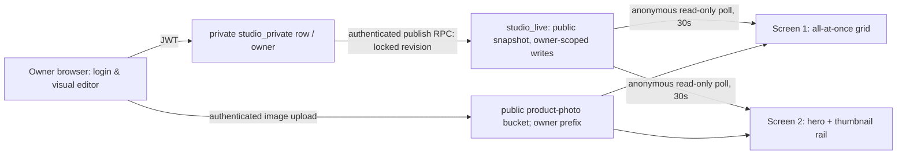

# 0002 — Secure online owner editing and live café displays

**Status:** Accepted for implementation by owner request on 2026-11-07 (prior content/layout decisions approved); acceptance testing ongoing.

## Problem and goals
The existing studio stores changes in a single browser; the café owner needs to edit from a laptop and publish the same stable menu to two always-on portrait televisions. The owner rejects extra payments; product photos must show the complete cup. All published products must appear simultaneously on the full-menu screen, while individual showcase ads rotate separately.

## Constraints and non-goals
Preserve visual editor, screen configuration, Fraunces/DM Sans choice, image-first grid, prices and ingredients. No new design tools, paid rendering, checkout, SaaS subscriptions, or automatic AI video generation. Only the published snapshot may appear on screens. The local-only prototype and its reference menu are not verified facts until the owner checks them.

## Approved direction and alternatives
**Selected:** static browser frontend on a no-cost commercial-compatible static host; Supabase Auth + RLS + Storage, private draft and separate public published snapshot. Pros: existing project, synchronized TVs, free-tier candidate, minimal moving parts. Owner connects GitHub to Cloudflare Pages (free) once. Alternative local-only page rejected (no cross-device updates); GitHub Pages rejected (not licensed for commercial app hosting); Supabase Edge Function as static HTML rejected (on default domain, text/html is rewritten to text/plain); Vercel Hobby rejected (noncommercial restriction); server-rendered custom backend deferred as unnecessary.

## Data / architecture

- `studio_private(owner_id UUID PK, draft JSONB)` protected by auth.uid() RLS.
- `studio_live(owner_id UUID PK, published JSONB, revision INT, published_at)` public SELECT; inserts/updates through authenticated RPC only.
- `studio_history(owner_id, revision, published)` private historic versions for rollback.
- `publish_studio()` checks auth.uid(), loads draft, validates minimal structure, locks publication row, appends previous revision to history, atomically publishes the new version, returns revision. `rollback_studio(revision)` authenticates owner and restores prior revision atomically.
- `menu-products` public-image bucket (only products, no PII); authenticated upload names scoped to user's UID; owner cannot write another owner's prefix. Photos must be >0 and <=6 MB and image MIME. Photos never automatically attached to a different product.
- Owner signs in with Supabase email/password. Owner onboards using Supabase's normal signup/confirmation; no admin service key in browser or repo.
- Screens use `?screen=<id>&owner=<uuid>`, anonymous read only `studio_live`. Reload/poll on 30s, retain most recent successful snapshot on transient fetch failure; no partial draft exposure.
- Full-image rendering must always use CSS contain, with no transform scaling that clips cup top/bottom.

## Threat model (STRIDE)
- Spoofed owner / credential theft: Supabase Auth, TLS, RLS, password sign-in, no secret key in client; owner should use strong password and MFA where available.
- Tampering/IDOR: private rows restricted by `auth.uid()`; publish/rollback RPC explicit auth + table locks; only editor can upload to own storage path.
- Repudiation: revision number, published_at, history allow owner rollback and timing audit; not a full immutable ledger.
- Information disclosure: no private drafts on anonymous endpoint; uploaded product images are deliberately public, so owner must not upload private material. Client publishable key is public; service keys never committed.
- Denial of service: per-file 6 MB, bucket object cap, public display cache-last-known-good; free-tier thresholds and inactive project pausing remain operational risks.
- Elevation of privilege: function `SECURITY DEFINER` limited to authenticated, explicit `auth.uid()` gate, fixed `search_path`, no dynamic SQL, schema-qualified names; revoke public EXECUTE.

## Rollout and acceptance
1. Apply DB/security migration; run RLS tests/advisors. 2. Build live adapter and mobile/TV screens; test complete cup, image upload and publish flows with mocked auth plus remote table role checks. 3. Push reviewed frontend to GitHub, connect Cloudflare Pages static deployment (user action). 4. Owner creates/signs into account, uploads correct product photos and verifies all names/prices. 5. Open screen URLs on two real Samsung TVs; test 30-minute uninterrupted playback and 30-second publication sync. 6. Record real TV/browser observations and add rollback test.

**Incomplete/needs owner verification:** account signup and email confirmation, live TV model/browser, reading distance, menu transcription, commercial usage free-tier quota; connected Cloudflare account not yet authorized. Do not claim production readiness before these checks.