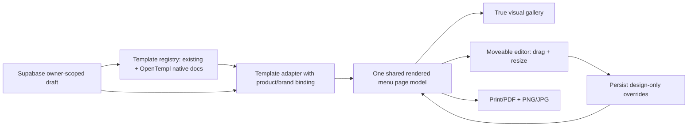

# Actual open-source menu documents and direct editing
**Status:** Accepted — explicit owner instruction to implement the previously approved experience, 2026-11-27.

## Problem
Owners see 24 combinations of eight custom Seiyun layouts; browse thumbnails are abstract color blocks. Current preview permits contenteditable words and image zoom, but no freehand drag/resize, reflow or accurate picture thumbnails. 26 products span unnecessary pages and leave whitespace. Existing screenshots and chat requirements insist on real prepared menu templates, a usable visual gallery, drag-to-edit brand/product-card positions, and outputs matching preview, all filled by Supabase.

## Goals / success criteria
- Add at least **18 genuinely sourced licensed menu designs** from existing open-source design documents, not merely color skins; retain 24 existing combinations. Attribute source and license with no third-party demo imagery.
- Gallery must display an **actual scaled rendered first page** with the owner's real product names/prices/photos and brand, not color placeholders. Search by type/name; no owner data sent to third-party services.
- Tap to select brand/product/photo on the artwork; drag/resize using MIT Moveable (on touch and desktop); update saved per-design layout overrides. Price/name edits update underlying product; moving/resizing changes only layout settings.
- Repack existing multi-item menus so shrinking a card removes unused space, without dropping/duplicating products. Print, PNG, JPG reflect approved positions and resized elements, not just editor CSS.
- Keep current auth, RLS, routes, previous drafts, originals, data migration-free.

## Non-goals
- Import all 337 OpenTempl cross-category designs or treat posters/brochures as menu templates without content mapping.
- Execute arbitrary repository scripts or allow unsafe external assets in customer browsers.
- Promise pixel-perfect conversion of an entire unrelated editor's interaction model.
- Put TV publication, separate editing forms or repeated AI calls into owner's normal flow.

## Source adaptation
Use OpenTempl MIT native JSON menu documents from `apps/editor/public/templates/*.json`, curated from the registry to include actual café/food/price-list designs (not all marketing templates). Vend the original selected JSON elements and source IDs, source repo revision/license. Render element types `text`, `shape`, `line`, `image` from the **actual source coordinates and typography**. Map owner brand and product slots in reading order (name, nearest price, description) and overflow onto additional pages while preserving theme; an unfilled source demo product must never remain on a published menu. Use only owner photos; no stock images. Real preview and download share the exact HTML renderer.

## Data
`draft.menuArtwork` retains current fields; add optional `layoutOverrides[templateId][elementKey]` normalized `{x,y,w,h,fontSize,order}` with safe bounds. `draft.menuArtwork.photoTransformByProduct` existing preserved. Source documents keyed `opentempl:<sourceId>` in registry with source metadata. Maps to existing owner product UUIDs, never by display name. HTML escapes all data; data URI SVG/embed blocked.

## Architecture

## STRIDE
S: unchanged authenticated Supabase account + RLS; no cross-tenant template edits. T: sanitize user text, URLs and CSS numbers; template JSON vendored/reviewed, no runtime arbitrary GitHub fetch. R: existing private draft revision metadata; design edits not silently published. I: previews only local already-authorized data; never transmit images to upstream websites. D: bound number of source elements/previews and limit pagination; off-screen renders lazy; prevent giant data URIs or unbounded object dimensions. E: no third-party script execution from template JSON; recognized element types + whitelisted props only, stable source license.

## Alternatives
A. Keep color-swatches/custom 8 layouts (cheap, rejected—does not match real gallery). B. Adopt entire OpenTempl/Canvix SaaS app (true editor but duplicate auth/persistence and major migration). **C selected:** import exact open-source menu document formats into current source-of-truth renderer and overlay mature Moveable control, preserving export pipeline.

## Rollout/tests
Red/green tests prove source IDs/images, source element geometry, no dummy products, all 26 records exactly once, content-aware compact pages, source/crop safety, touch-coordinate conversion, persisted drag/resize matching PDF/PNG and brand style. Browser tests for 390px mobile and desktop. Existing 24 designs preserved. No merge until these pass and examples visually reviewed. **Missing references:** `assets/spec-template.md`, `assets/threat-model.md`; equivalent sections are provided here.
