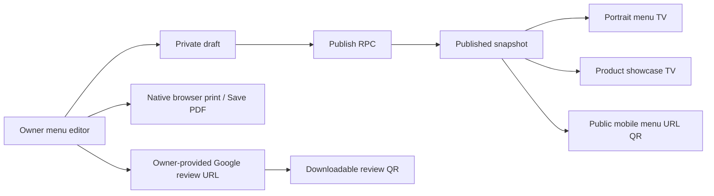

# 0003 - Samsung TV access, printable menu and QR codes
Status: In review (2026-11-07)

## Problem
The owner needs to place the existing published two-screen menu on portrait Samsung TVs, print a complete menu/PDF when needed, and offer scannable menu/review links. The previous interface had no PDF or QR tools; a portrait TV layout is unreadable on a phone.

## Goals and non-goals
- Preserve the currently approved, photo-first TV visuals and direct editing workflow.
- Print draft or published full catalog, with category headings, image areas, ingredients, sizes and prices. Standard browser print dialog provides printing or Save as PDF.
- Generate downloadable PNG QRs locally for the public mobile menu and for an official Google Business Profile review-request link supplied by the owner.
- Customer mobile QR page reads only published Supabase data and refreshes periodically. Draft edits stay private.
- Avoid payment/subscriptions, additional tables/secrets, or changing owner login/RLS.
- Do not claim physical Samsung compatibility until onsite test; don't invent a Google review URL or change TV screen layout to make room for QRs.

## Design

- Add `studio/menu-extras.js` and `studio/menu-extras.css` (scoped styles).
- Display a print + QR panel in Screens and Published sections. A draft field `reviewUrl` stores the owner's HTTPS Google review-request URL, published with the next approved menu snapshot.
- Public route `?catalog=1&owner=<owner_uuid>` shows a phone-friendly full menu from `studio_live`; never requires login or reads `studio_private`. The existing display routes remain unchanged.
- QRs use pinned MIT-licensed QRCode.js 1.0.0. No third-party QR generation service. Download as PNG and/or print signage.
- Native `window.print()` for crisp printer/PDF text, avoiding paid PDF servers. A4 CSS uses break-safe cards and the whole catalog.

## Threat model
- Spoofing: Google review destination must be HTTPS at Google-controlled hostnames; show destinations alongside QRs.
- Tampering/privilege escalation: public route reads only `studio_live` via existing Supabase RLS; public cannot write drafts or published data.
- XSS: escape uploaded descriptions, names, URLs and product labels when rendering printable HTML and public mobile cards.
- Information disclosure: public mobile QR never exposes owner emails, unapproved drafts, access tokens or private photos.
- Denial of service: local QR and PDF printing run in the browser, not a billable server. CDN library may be blocked, so control reports an error instead of substituting unrelated QR.
- Supplier risk: pin QRCode.js version. Recommend self-hosting reviewed library before critical always-offline use.

## Alternatives and trade-offs
- Paid PDF generation service: rejected due to explicit zero-new-fee requirement.
- Raster screen-screenshot PDF: rejected because dense product information becomes blurry and pagination unreliable.
- QR pointing straight to 9:16 TV screen: rejected for poor mobile readability; use dedicated responsive published catalog.

## Verification and rollout
- Browser mock test: all 23 items in draft PDF popup, 2 A4 pages without clipping, preview of menu/Google QR, invalid link rejected, PNG download event, Published route, mobile public catalog with no login, no uncaught errors.
- Requires manual confirmation on actual Samsung models: browser, 9:16 physical orientation, full-screen, portrait rendering, long-run refresh, power/sleep timer.
- Requires Cloudflare Worker build/redeploy after merge. Never represent GitHub merge as proof that Worker has deployed.
- Google review QR remains inactive until owner pastes the exact link, obtained from Google Business Profile.

