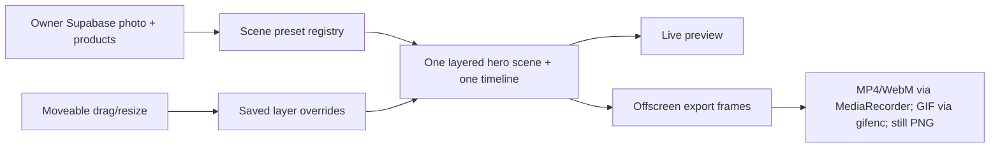

# Reusable hero-product animated advertisement scenes
**Status:** Accepted — owner explicitly approved full-screen cinematic single-product concept, 2026-11-27.

## Problem
Product Showcase currently uses Motion Lab's six *multi-image gallery* modes. It creates many tiny copies of a drink, with almost no ingredient or background movement, and exports a separate simplified composition that doesn't match the preview. Users want ONE large drink with visually meaningful animated background, ingredients/glow/text, brand and suitable color by product, all previewed live and exported anywhere, at no per-export AI cost.

## Goals / measurable acceptance
- At least five genuinely different reusable *single-product* scenes: **Cinematic Reveal, Ingredient Motion, Spotlight, Fresh Energy, Warm Café**. Every effect has exactly one principal product photo, occupies 50–80% of composition hero area, with distinct animated environmental layers.
- Automatically select sensible palette by category/ingredient and brand, with optional manual color/scene selection. Text, photo, product size and position editable by dragging/resizing on preview; scene remains playable.
- Same deterministic timeline and scene model for live preview and GIF/video/poster output; true moving background and correct output file type/duration (not static screenshot). Existing original product photo preserved; optional white-background cutout only when safe.
- Browser-native MP4/WebM when supported, GIF fallback, PNG still; no paid subscription or repeated AI model calls. Existing owner catalog/branding used; no new DB.

## Non-goals
- Realistic fluid pouring physically simulated from a single still (requires footage/3D/generative media).
- Import a paid/proprietary stock library with unclear image rights.
- Make a TV player or require publishing to the website.

## Architecture

Use a MIT-licensed animation player (Anime.js or equivalent), not Motion Lab gallery modes. Scene layers are CSS/SVG/audio-free visual elements with deterministic keyframe curves. Runtime animation loop shared with frame capture. Product ingredient list only influences icons/colors by a reviewed flavor vocabulary; never render unrelated sample photos/claims. Product cutout if near-white cannot blindly remove cream/foam; preserve original and offer comparison.

Data: `draft.showcaseArtwork` `sceneId`, `background`, `duration`, `speed`, `layerOverrides` with x,y,scale/font. Keep `productId` and selected `showcasePrimary`.

## STRIDE
S: authenticated owner's photo URLs only. T: whitelist scene ID and override bounds, escape text, URL scheme. R: preserve draft storage history. I: assets local or public licensed, no data sent to AI or analytics. D: cap capture duration, resolution and frames. E: prevent arbitrary scripts/template code, keep versioned permissive licenses. Browser codec detection must not claim MP4 on unsupported Safari.

## Alternatives
A. Keep Motion Lab galleries (rejected, multiple copies). B. AI video every export (rejected cost/control). **C chosen:** reusable MIT timeline/scene engine; separate optional one-time generative assets future when explicitly enabled. 

## Test proof
Two contrasting drinks (Saffron and Matcha) use distinct backgrounds/ingredient graphics; frame 0/50/100% visually differ; only one hero image, drag/resize saves and displays in exported PNG/frames; selected product independent of legacy screen category; generated GIF is playable (multiple frames) and browser native MP4/WebM matches preview. Test iPhone Safari touch and export support explicitly. User must see visual result; green unit tests alone do not establish quality.
